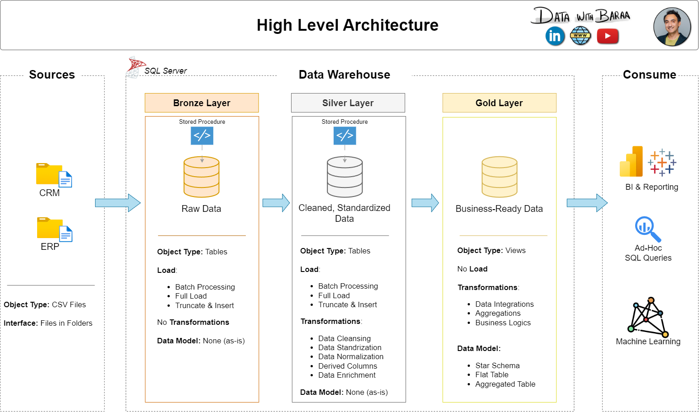

# Data Warehouse and Analytics Project

This project demonstrates an end-to-end data warehousing solution built from CRM and ERP CSV files, processed in MySQL and modeled for analytics. It follows a Medallion Architecture approach to turn raw source data into clean, business-ready reporting tables.


---

## 🏗️ Data Architecture

The project is structured around the **Bronze**, **Silver**, and **Gold** layers:



1. **Bronze Layer**: Raw data is ingested from CRM and ERP CSV files into MySQL.
2. **Silver Layer**: Data is cleaned, standardized, and normalized for consistency.
3. **Gold Layer**: Business-ready tables are modeled for reporting and dashboarding.

---

## 📌 Project Overview

This repository covers:

1. **Data ingestion** from source CSV files
2. **ETL pipelines** for data transformation and validation
3. **Data modeling** with star-schema style analytics tables
4. **Reporting and insights** using SQL-based analysis

Key focus areas:
- MySQL database setup
- Data warehouse design
- CRM + ERP integration
- Analytical SQL queries

---

## 🛠️ Tools and Stack

- **MySQL**: Primary database engine for storage and transformation
- **MySQL Workbench**: Database development and management
- **Git & GitHub**: Version control and project tracking
- **Draw.io**: Architecture and flow diagramming
- **CSV datasets**: Source data for CRM and ERP systems

---

## 📂 Repository Structure

```text
data-warehouse-project/
│
├── datasets/                           # Raw CRM and ERP CSV files
├── docs/                               # Project documentation and diagrams
│   ├── etl.drawio
│   ├── data_architecture.drawio
│   ├── data_catalog.md
│   ├── data_flow.drawio
│   ├── data_models.drawio
│   └── naming-conventions.md
├── scripts/                            # SQL scripts for ETL and modeling
│   ├── bronze/
│   ├── silver/
│   ├── gold/
│   ├── mysql/
│   └── init_database.sql
├── tests/                              # Validation and quality checks
├── README.md                           # Project overview and instructions
├── LICENSE                             # License information
├── .gitignore
├── requirements.txt
└── docs/requirements.md                # Project requirements and scope
```

---

## ⚡ Interactive Project Flow

<details>
<summary><strong>Click to expand: project flow</strong></summary>

1. Upload CRM and ERP CSV files into the raw staging area.
2. Create the MySQL databases and schema structure.
3. Load the data into the Bronze layer.
4. Clean and normalize fields in the Silver layer.
5. Build business-ready analytical tables in the Gold layer.
6. Run SQL queries to generate insights and reports.

</details>

---

## 🚀 How to Run

1. Install **MySQL** and **MySQL Workbench**.
2. Open a MySQL client or terminal and connect to your local instance.
3. Run the initialization scripts in the `scripts/mysql/` folder to create the required databases.
4. Load the CRM and ERP CSV files into the raw tables.
5. Execute the Bronze, Silver, and Gold SQL scripts in sequence.
6. Query the final tables to explore sales, customer, and product insights.

Example workflow:

```bash
mysql -u root -p < scripts/mysql/00_init.sql
```

Then run the SQL scripts in order from the `scripts/` directories using MySQL Workbench or the MySQL CLI.

---

## 🧪 Example Use Cases

- Customer segmentation and retention analysis
- Product performance and sales trend reporting
- ERP and CRM data reconciliation
- Data warehouse testing and validation

---

## 🛡️ License

This project is licensed under the [MIT License](LICENSE). You are free to use, modify, and share it with attribution.
